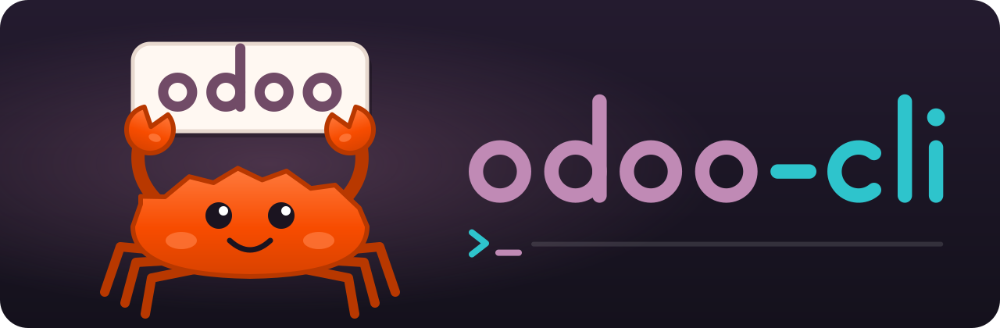

<p align="center">
  
</p>

<p align="center">
  <b>Odoo from your shell. One static binary, built for AI agents and old hardware.</b>
</p>

<p align="center">
  <a href="https://github.com/agustinustheo/odoo-macmini-core2duo/actions/workflows/ci.yml"></a>
  <a href="https://github.com/agustinustheo/odoo-macmini-core2duo/releases/latest"></a>
  <a href="LICENSE"></a>
  <a href="https://github.com/agustinustheo/odoo-macmini-core2duo/releases"></a>
  <br>
  
  
  
  
  <br>
  <a href="https://github.com/agustinustheo/odoo-macmini-core2duo/stargazers"></a>
  <a href="https://github.com/agustinustheo/odoo-macmini-core2duo/graphs/contributors"></a>
  <a href="https://github.com/agustinustheo/odoo-macmini-core2duo/commits/main"></a>
</p>

---

`odoo-cli` reads and changes Odoo data from the command line: tasks, projects,
timesheets, invoices, messages, people. It is one 3 MB file with no runtime,
no daemon and no MCP server, so it runs happily on a 2008-era Intel Core 2 Duo
and leaves the machine's RAM to everything else.

It was built for Claude Code and other coding agents, so every command prints
JSON, every failure has a stable exit code, and field names are checked against
your server before anything is sent.

## Highlights

- **One file.** Static musl binary. No Python, Node, OpenSSL or CA bundle needed.
- **Light.** About 3.5 MB of RAM per call. Blocking HTTP, gzip, no async runtime.
- **Agent-friendly.** JSON on stdout, JSON errors on stderr, exit codes `0`–`4`,
  `--dry-run` on every write, and a built-in guide (`odoo-cli guide`).
- **Accurate.** Unknown fields are rejected locally with "did you mean"
  suggestions; field metadata is cached for 24 hours.
- **Sees pictures.** Images and files attached to chatter and Discuss messages
  (including pasted inline images) download to disk, so an agent can open them.
- **Version-aware.** JSON-2 on Odoo 19+, JSON-RPC on older versions, and
  per-version handling for attachments, grouping and access checks.

## Install

Download the binary. That's it.

```bash
curl -fL -o ~/.local/bin/odoo-cli \
  https://github.com/agustinustheo/odoo-macmini-core2duo/releases/latest/download/odoo-cli-x86_64-linux
chmod +x ~/.local/bin/odoo-cli
odoo-cli --version
```

Each release also has a `.sha256` checksum, the `LICENSE` and the
`THIRD-PARTY-NOTICES.md` for the crates inside the binary.

## Connect

1. In Odoo: avatar → **My Profile** → **Account Security** → **New API Key**.
   On Odoo 20, choose the **RPC** scope.
2. Run setup and paste the key when asked:

```bash
odoo-cli setup --url https://yourcompany.odoo.com --db yourcompany --login you@example.com
odoo-cli whoami
```

The key is stored in `~/.config/odoo-cli/<profile>.key` with mode `0600`.
Use `--profile` (or `ODOO_PROFILE`) for several Odoo databases.

## Tour

```bash
odoo-cli tasks --mine --open                          # my open tasks, most urgent first
odoo-cli tasks --mine --stage Review                  # what is waiting in Review
odoo-cli update project.task 42 '{"stage_id": 3}'     # move a task
odoo-cli timesheet log --task 42 --hours 1.5 -d "Code review"
odoo-cli aggregate account.move '[["move_type","=","out_invoice"],["state","=","posted"]]' \
  -g invoice_date:month -a amount_total:sum           # invoiced per month
odoo-cli chatter read project.task 42 --download images
odoo-cli chat send 9 "On my way"
odoo-cli fields res.partner --search email            # discover fields before writing
odoo-cli search res.users '[]' -f name,login,active
```

Run `odoo-cli guide` for every recipe (tasks, projects, finance, timesheets,
messages, attachments, users) and `odoo-cli --help` for the full command list.

### Images in messages

```bash
$ odoo-cli chatter read project.task 42 -l 1 --download images --pretty
{
  "records": [{
    "body": "Login page breaks on mobile:\n[image #3521]",
    "attachments": [{
      "id": 3521, "name": "Screenshot.png", "mimetype": "image/png",
      "path": "/home/me/.cache/odoo-cli/default/attachments/3521-Screenshot.png"
    }]
  }]
}
```

Agents open `path` with their file reader to see the picture. Files are cached,
so reading the thread again does not download them again.

## For AI agents

- **Claude Code:** copy the skill so every thread knows the tool exists:

  ```bash
  mkdir -p ~/.claude/skills/odoo && cp skill/SKILL.md ~/.claude/skills/odoo/
  ```

- **Any other agent:** add one line to its instructions:
  *"For anything involving Odoo, use `odoo-cli`. Run `odoo-cli guide` first."*

Exit codes: `0` ok · `1` Odoo refused · `2` bad input or unknown field ·
`3` profile or authentication · `4` network.

## Odoo versions

| | Odoo ≤18 | Odoo 19 | Odoo 20 |
|---|---|---|---|
| Protocol | JSON-RPC (`execute_kw`) | JSON-2 | JSON-2 |
| Tested live | not yet | ✅ | ✅ |

Version differences handled for you are listed in [docs/SPEC.md](docs/SPEC.md).

## Build from source

```bash
rustup target add x86_64-unknown-linux-musl
cargo test
cargo build --release --target x86_64-unknown-linux-musl
```

About two minutes on a Core 2 Duo. The release build targets baseline x86-64,
so it runs on CPUs without POPCNT, SSE4.2, AVX or AES-NI.

| Path | What |
|---|---|
| `src/client.rs` | JSON-2 and JSON-RPC transport, error mapping |
| `src/schema.rs` | field cache, validation, suggestions |
| `src/attachments.rs` | message and record files, uploads, image fields |
| `src/config.rs` | profiles and API key storage |
| `src/main.rs` | commands |
| `docs/AGENT_GUIDE.md` | the text printed by `odoo-cli guide` |
| `scripts/make_logo.py` | generates `assets/logo.svg` |

## License

`odoo-cli` is free software under the
[GNU Affero General Public License v3.0 only](LICENSE) (`AGPL-3.0-only`).
Third-party crates in the binary keep their own licenses, listed in
[THIRD-PARTY-NOTICES.md](THIRD-PARTY-NOTICES.md). How the implementation
relates to other Odoo tools is documented in [docs/PROVENANCE.md](docs/PROVENANCE.md).

<sub>Odoo is a trademark of Odoo S.A. This project is independent and is not
affiliated with or endorsed by Odoo S.A. The crab is drawn after Ferris, the
unofficial Rust mascot, which is in the public domain.</sub>
